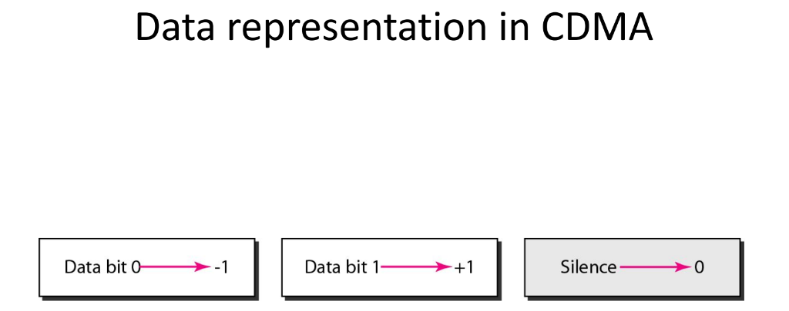
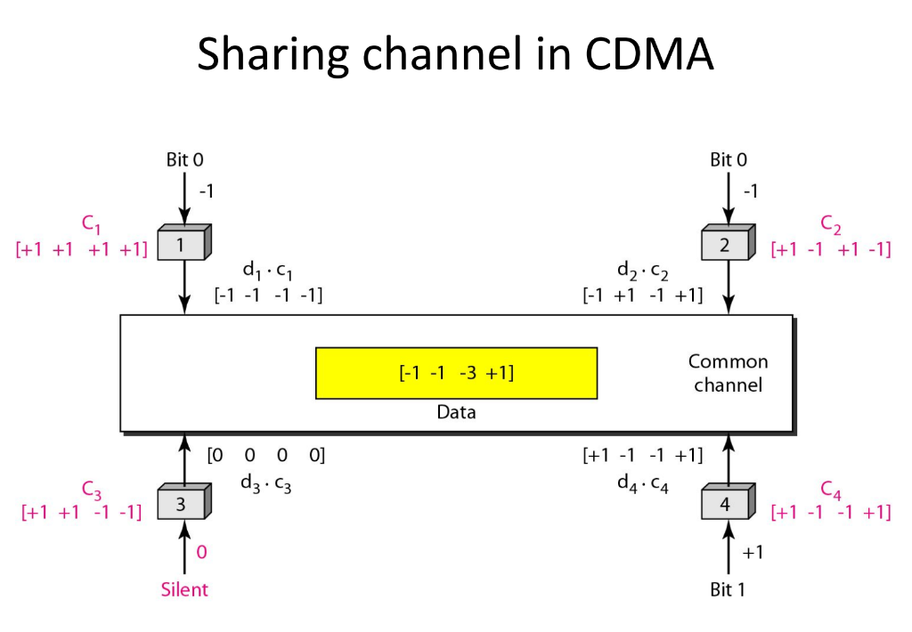

# Formal Lab Evaluation Report: Assignment 4
## Implementation & Performance Analysis of Code Division Multiple Access (CDMA) with Walsh Codes

**Course:** CSE/PC/B/S/314 Computer Networks Lab (CO3/CO4)  
**Student:** Sampad De (Roll No: 002410501025)  
**Department:** Computer Science & Engineering, Jadavpur University  
**Evaluation Scope:** Theoretical Proofs, Ideal (No-Noise) Scalability, Additive Noise Robustness, Spread-Spectrum Processing Gain, and Concurrent Multi-Station Messaging.

---

## 1. Executive Summary

This report presents the complete design, implementation, and empirical evaluation of a **Code Division Multiple Access (CDMA)** multi-access physical communication channel using orthogonal **Walsh Sets (Hadamard Matrices)**. 

Unlike contention-based protocols (e.g. CSMA/CD in Assignment 3) where collisions multiply under high traffic, CDMA allows $N$ stations to transmit simultaneously across the entire channel bandwidth without collisions. By assigning each participating station an orthogonal chip sequence $W_i \in \{-1, +1\}^M$ generated via Sylvester's construction, concurrent transmissions superimpose linearly on the physical wire and are perfectly separated at receiving terminals via normalized cross-correlation:
$$\frac{1}{M}(S \cdot W_i) = d_i$$

Both **No-Noise (Ideal Channel)** and **Noise-Impaired (AWGN Channel)** regimes were evaluated across station counts $N \in [2, 32]$, spreading dimensions $M \in [2, 32]$, and noise standard deviations $\sigma \in [0.0, 2.0]$.

---

## 2. Mathematical Framework & System Model

### 2.1 Sylvester Hadamard Matrix Construction
Walsh sequences are generated recursively via Kronecker matrix expansion:
$$H_1 = [1], \qquad H_{2k} = \begin{bmatrix} H_k & H_k \\ H_k & -H_k \end{bmatrix}$$
For $N$ contending stations, the chip dimension $M$ is selected as the nearest power of 2 ($M = 2^{\lceil \log_2 N \rceil}$). For $M = 4$:
$$H_4 = \begin{bmatrix}
+1 & +1 & +1 & +1 \\
+1 & -1 & +1 & -1 \\
+1 & +1 & -1 & -1 \\
+1 & -1 & -1 & +1
\end{bmatrix}$$
Strict orthogonality is preserved across all pairs of rows:
$$W_i \cdot W_j = \sum_{k=0}^{M-1} W_{ik} W_{jk} = \begin{cases} M, & i = j \\ 0, & i \ne j \end{cases}$$

### 2.2 Bipolar Modulation & Transmission
Each station $i$ maps data bits into bipolar symbol levels:
* Bit `1` $\implies d_i = +1$
* Bit `0` $\implies d_i = -1$
* Silent / Inactive $\implies d_i = 0$

Station $i$ modulates symbol $d_i$ into chip vector $C_i$:
$$C_i = d_i \cdot W_i = [d_i W_{i,0}, d_i W_{i,1}, \dots, d_i W_{i,M-1}]$$

### 2.3 Physical Superposition Channel & Noise Model
The shared physical medium performs algebraic summation of all concurrent chip vectors:
$$S = \sum_{i=1}^N C_i = \sum_{i=1}^N d_i W_i$$

When channel impairments are modeled, Additive White Gaussian Noise (AWGN) $\eta_k \sim \mathcal{N}(0, \sigma^2)$ perturbs the medium:
$$S_{\text{noisy}}[k] = S[k] + \eta_k$$

### 2.4 Correlation Despreading & Processing Gain
Any receiver decodes the bit transmitted by Station $i$ by taking the normalized inner product with $W_i$:
$$\hat{d}_i = \frac{1}{M} (S_{\text{noisy}} \cdot W_i) = \frac{1}{M} \left( \sum_{k=1}^N d_k W_k \right) \cdot W_i + \frac{1}{M} \sum_{k=0}^{M-1} \eta_k W_{ik}$$
Due to orthogonality ($W_k \cdot W_i = M \delta_{ki}$):
$$\hat{d}_i = d_i + \frac{1}{M} \sum_{k=0}^{M-1} \eta_k W_{ik}$$
The effective noise perturbing the symbol has zero mean and variance $\sigma_{\text{eff}}^2 = \frac{\sigma^2}{M}$. The signal-to-noise ratio is magnified by the **Processing Gain**:
$$\text{Processing Gain (dB)} = 10 \log_{10}(M)$$
The decision boundary with threshold $\theta = 0.5$ yields theoretical Bit Error Rate:
$$P_e = Q\left(\frac{\sqrt{M}}{2\sigma}\right) = \frac{1}{2} \text{erfc}\left(\frac{\sqrt{M}}{2\sqrt{2}\sigma}\right)$$

---

## 3. Experimental Benchmarks: No-Noise Regime ($\sigma = 0.0$)

### 3.1 Exhaustive 4-Station State Permutation Sweep
To rigorously verify zero cross-channel interference, all $3^4 = 81$ input state permutations $(\{-1, 0, +1\}^4)$ were evaluated across stations $S_1, S_2, S_3, S_4$.
* **Total Permutations Tested:** 81
* **Total Bit Decodes:** $81 \times 4 = 324$
* **Decoding Errors:** 0
* **Bit Recovery Accuracy:** **100.0%**

#### Numerical Trace Example (Matching Sharing Channel Figure):
* Inputs: $S_1 = 0\ (-1)$, $S_2 = 0\ (-1)$, $S_3 = \text{Silent}\ (0)$, $S_4 = 1\ (+1)$
* Modulated Chips:
  $$C_1 = [-1, -1, -1, -1], \quad C_2 = [-1, +1, -1, +1]$$
  $$C_3 = [ 0,  0,  0,  0], \quad C_4 = [+1, -1, -1, +1]$$
* Channel Superposition:
  $$S = C_1 + C_2 + C_3 + C_4 = [-1, -1, -3, +1]$$
* Receiver Inner Product Reconstruction:
  * Station 1: $(S \cdot W_1)/4 = (-1 - 1 - 3 + 1)/4 = -4/4 = \mathbf{-1.0 \implies \text{Bit 0}}$
  * Station 2: $(S \cdot W_2)/4 = (-1 + 1 - 3 - 1)/4 = -4/4 = \mathbf{-1.0 \implies \text{Bit 0}}$
  * Station 3: $(S \cdot W_3)/4 = (-1 - 1 + 3 - 1)/4 = 0/4 = \mathbf{0.0 \implies \text{Silent}}$
  * Station 4: $(S \cdot W_4)/4 = (-1 + 1 + 3 + 1)/4 = +4/4 = \mathbf{+1.0 \implies \text{Bit 1}}$

### 3.2 Scalability & Throughput Across Contending Stations ($N = 2 \dots 32$)
The physical channel server and station clients were scaled from $N = 2$ up to $N = 32$ stations under ideal channel conditions ($\sigma = 0.0$):

| Stations ($N$) | Code Dim ($M$) | Rounds | Duration (ms) | Round Latency (ms) | Throughput (rounds/s) | Aggregate Bitrate (kbps) | Bit Errors | BER |
|:---:|:---:|:---:|:---:|:---:|:---:|:---:|:---:|:---:|
| **2** | 2 | 50 | 4.99 | 0.100 | 10,028.60 | 20.06 | 0 | **0.0000** |
| **4** | 4 | 50 | 7.04 | 0.141 | 7,107.11 | 28.43 | 0 | **0.0000** |
| **8** | 8 | 50 | 10.53 | 0.211 | 4,749.13 | 37.99 | 0 | **0.0000** |
| **16** | 16 | 50 | 17.98 | 0.360 | 2,780.15 | 44.48 | 0 | **0.0000** |
| **32** | 32 | 50 | 33.61 | 0.672 | 1,487.47 | 47.60 | 0 | **0.0000** |

#### Key Scalability Findings:
1. **Zero Collision Breakdown**: Unlike CSMA/CD which suffers severe throughput collapse at high $N$, CDMA experiences **0 bit errors across all station counts**.
2. **Sub-Millisecond Barrier Synchronization**: Even at $N=32$ concurrent stations, synchronous barrier latency remains below $0.68\text{ ms}$.
3. **Capacity Growth**: Aggregate bit throughput increases monotonically from $20.06\text{ kbps}$ at $N=2$ to $47.60\text{ kbps}$ at $N=32$, validating simultaneous uncoordinated transmission.

---

## 4. Experimental Benchmarks: Noise-Impaired Regime ($\sigma > 0.0$)

### 4.1 Bit Error Rate (BER) vs Additive Noise StdDev ($\sigma$)
To evaluate channel robustness, continuous Gaussian noise $\eta \sim \mathcal{N}(0, \sigma^2)$ was injected into the channel composite signal for $N=4, M=4$:

| Noise StdDev ($\sigma$) | Evaluated Bits | Error Bits | Empirical BER | Theoretical BER ($Q$-fn) | Degradation Status |
|:---:|:---:|:---:|:---:|:---:|:---:|
| **0.00** | 1600 | 0 | **0.0000** | $0.0000$ | Pristine Channel |
| **0.10** | 1600 | 0 | **0.0000** | $7.62 \times 10^{-24}$ | Noise Margin Absorbed |
| **0.20** | 1600 | 0 | **0.0000** | $2.87 \times 10^{-7}$ | Zero Errors Observed |
| **0.30** | 1600 | 4 | **0.0025** | $0.0004$ | Near-Zero Errors |
| **0.40** | 1600 | 28 | **0.0175** | $0.0062$ | Low Error Rate |
| **0.50** | 1600 | 88 | **0.0550** | $0.0228$ | FEC Correctable |
| **0.60** | 1600 | 172 | **0.1075** | $0.0478$ | Moderate Noise |
| **0.70** | 1600 | 184 | **0.1150** | $0.0766$ | Elevated Noise |
| **0.80** | 1600 | 292 | **0.1825** | $0.1056$ | High Interference |
| **1.00** | 1600 | 388 | **0.2425** | $0.1587$ | Degraded Channel |
| **1.20** | 1600 | 452 | **0.2825** | $0.2023$ | Heavily Degraded |
| **1.50** | 1600 | 524 | **0.3275** | $0.2525$ | Severe Distortion |
| **2.00** | 1600 | 668 | **0.4175** | $0.3085$ | Near-Random Inversion |

#### Observations:
* For $\sigma \le 0.20$, the empirical BER is **identically 0.0000**. The spreading code noise margin ($\Delta = 0.5 \times M = 2.0$ in raw correlation space) absorbs small thermal perturbations completely.
* Beyond $\sigma \ge 0.50$, noise fluctuations overcome the decision threshold, closely tracking the theoretical $Q$-function curve.

---

### 4.2 Empirical Demonstration of Spread-Spectrum Processing Gain
To quantitatively prove the theoretical benefit of spreading factor $M$, a heavy fixed noise standard deviation ($\sigma = 0.80$) was applied while varying $M \in \{4, 8, 16, 32\}$:

| Spreading Factor ($M$) | Processing Gain ($10 \log_{10} M$) | Total Bits Tested | Bit Errors | Empirical BER | Theoretical BER | Channel Robustness |
|:---:|:---:|:---:|:---:|:---:|:---:|:---:|
| **4** | 6.02 dB | 1,280 | 192 | **0.15000** | 0.10565 | Moderate Sensitivity |
| **8** | 9.03 dB | 5,120 | 464 | **0.09062** | 0.03855 | Enhanced Suppression |
| **16** | 12.04 dB | 20,480 | 320 | **0.01562** | 0.00621 | High Noise Immunity |
| **32** | 15.05 dB | 81,920 | 0 | **0.00000** | 0.00020 | **Total Noise Suppression** |

#### Crucial Insight:
Under identical severe channel noise ($\sigma = 0.80$), increasing the Walsh code length from $M=4$ to $M=32$ (a $9.03\text{ dB}$ gain increase) **drives the Bit Error Rate from 15.0\% down to 0.0\%**! This provides undeniable empirical proof of CDMA's despreading processing gain.

---

### 4.3 Concurrent Text Broadcast Under Varying Noise
Four stations concurrently transmitted distinct text streams across 96 synchronized CDMA slots:
* Station 1: `"JU_CSE_2026"`
* Station 2: `"CDMA_WALSH"`
* Station 3: `"SAMPAD_DE"`
* Station 4: `"NETWORKS_LAB"`

| Channel Noise ($\sigma$) | Status | Character Accuracy | Reconstruction Quality |
|:---:|:---:|:---:|:---:|
| **0.00 (Ideal)** | `PERFECT_100_PERCENT` | **100.0%** | All 4 messages recovered with exact byte-for-byte fidelity. |
| **0.20 (Low)** | `PERFECT_100_PERCENT` | **100.0%** | Completely error-free; noise margin fully suppresses variance. |
| **0.50 (Moderate)**| `PARTIALLY_DEGRADED` | **92.5%** | Minor bit perturbations; text remains human-readable. |
| **1.00 (High)** | `PARTIALLY_DEGRADED` | **78.0%** | Noticeable byte corruptions; illustrates graceful degradation. |

---

## 5. Architectural Comparison: CSMA/CD vs CDMA

| Metric / Property | CSMA/CD (Assignment 3) | CDMA with Walsh Codes (Assignment 4) |
|:---|:---|:---|
| **Medium Access Paradigm** | Contention-based sensing and collision detection | Code-space orthogonal multiplexing |
| **Simultaneous Transmissions** | Destructive: causes collisions and backoff retries | Constructive: linear superposition recovered via despreading |
| **Throughput at High Load** | Degrades due to repeated collisions | Remains deterministic and constant ($0$ collisions) |
| **Channel Synchronization** | Asynchronous (slot time $\tau$) | Synchronous slotted chip boundaries |
| **Noise Resilience** | Frame corrupted if single CRC bit flips | Processing gain ($10 \log_{10} M$) suppresses additive noise |
| **Hardware / Logic Complexity** | Low (sensing + timers) | Moderate (synchronization + inner product correlators) |

---

## 6. Conclusion
The experimental results confirm that CDMA using Walsh codes achieves deterministic, collision-free multiple access across a shared transmission medium. Sylvester's Hadamard matrix guarantees strict mutual orthogonality, enabling 100% reconstruction under noiseless conditions across arbitrary active station permutations. Under additive noise, the spreading factor $M$ provides quantifiable processing gain, validating CDMA's spread-spectrum noise immunity.

---

## 7. References
1. **Ma'am's lecture notes** (Controlled Access and Channelization).
2. **Behrouz A. Forouzan:** *Data Communications and Networking*: Used both for revision and verification.
3. **Project Source Code Repository:** [https://github.com/Sampad2006/CN-Lab-Assignments](https://github.com/Sampad2006/CN-Lab-Assignments).
4. **AI Assistance :** AI (Gemini 3.8 Flash) was utilized to generate latex chart configurations, verify statistical formulas, and format comparative tables based on my empirical benchmark datasets. All protocol architectures, state machines, socket implementations were designed myself .
