# Assignment 5: Packet Tracer and Traffic Analysis with Wireshark
## Laboratory Evaluation Report

**Course:** CSE/PC/B/S/314 Computer Networks Lab (CO4 / CO5)  
**Student Name:** Sampad De  
**Roll Number:** 002410501025  
**Department:** Computer Science & Engineering, Jadavpur University  
**Host Environment:** MacBook Air (`sampad@Sampads-MacBook-Air`), macOS Darwin, Wi-Fi Interface (`en0`)  
**Network Capture:** Live IEEE 802.11ac Wi-Fi link (97,552 packets analyzed)  

---

## 1. Executive Summary & Laboratory Objectives

This report documents the empirical analysis of live local-area and wide-area network traffic captured using the **Wireshark** protocol analyzer over an active IEEE 802.11ac Wi-Fi connection.

### Key Objectives:
* **ICMP & ARP Synchronization:** Verify the ARP broadcast/unicast address resolution sequence preceding ICMP Echo Request/Reply exchanges.
* **HTTP Transaction Timing:** Capture plain HTTP traffic against `neverssl.com` and calculate round-trip duration ($\Delta t = 381.562\text{ ms}$).
* **Application Header Hexadecimal Mapping:** Synchronize the Packet Details and Packet Bytes panels to map ASCII headers (`Host: neverssl.com`) to raw hex bytes (`48 6f 73 74`).
* **Bidirectional TCP Stream Tracking:** Reconstruct client-server dialogues using Wireshark's TCP stream reassembly engine.
* **Hardware Identification & Network Architecture:** Extract 48-bit MAC addresses and 24-bit OUIs, elucidating why the incoming frame carries the local default gateway's MAC (TP-Link) rather than the remote server's physical NIC, and evaluating the impact of macOS Private Wi-Fi MAC Address randomization.
* **Quantitative Protocol Distribution:** Profile the entire capture corpus (97,552 packets) via Protocol Hierarchy and generate time-sequence ladder diagrams via Flow Graph.

---

## 2. Design & System Architecture

### 2.1 Wireshark Capture Architecture
Wireshark captures raw network frames via `libpcap` on macOS (interfacing with the Berkeley Packet Filter kernel driver). Captured frames pass through protocol dissectors and are rendered across three synchronized panels:

```
+-----------------------------------------------------------------------------------+
| Physical Wi-Fi NIC (en0)  -->  Kernel BPF Driver (libpcap)  -->  Dissector Engine |
+-----------------------------------------------------------------------------------+
                                          |
        +---------------------------------+---------------------------------+
        |                                 |                                 |
        v                                 v                                 v
+-----------------------+     +-----------------------+     +-----------------------+
|   Packet List Panel   |     |  Packet Details Panel |     |   Packet Bytes Panel  |
| (Summary Table View)  |     | (Protocol Stack Tree) |     | (Hex & ASCII Dump)    |
+-----------------------+     +-----------------------+     +-----------------------+
```

### 2.2 Protocol Stack Encapsulation
Data generated during web requests undergoes multi-layer encapsulation before transmission:

```
[ Application: HTTP/1.1 ]   -> GET /index.html HTTP/1.1\r\nHost: neverssl.com...
          |
          v
[ Transport: TCP ]         -> Src Port: 50183, Dst Port: 80, Seq: 1, Ack: 1
          |
          v
[ Network: IPv4 ]          -> Src IP: 192.168.0.102, Dst IP: 34.223.124.45
          |
          v
[ Data Link: Ethernet II ] -> Src MAC: ee:16:f1:8c:06:01, Dst MAC: 98:ba:5f:0b:e5:dc
```

---

## 3. Implementation & Environment Setup

| System Parameter | Observed Value |
| :--- | :--- |
| **Client Machine** | Apple MacBook Air (`sampad@Sampads-MacBook-Air`) |
| **Operating System** | macOS Darwin (Unix) |
| **Capture Interface** | `en0` (802.11ac Wi-Fi Wireless Interface) |
| **Host IPv4 Address** | `192.168.0.102` (Class C private subnet `192.168.0.0/24`) |
| **Default Gateway IP** | `192.168.0.1` |
| **Host MAC Address** | `ee:16:f1:8c:06:01` (macOS Private Wi-Fi randomized MAC) |
| **Gateway MAC Address** | `98:ba:5f:0b:e5:dc` / `ba:5f:0b:e5:dc` (TP-Link Technologies) |
| **Target Web Server** | `neverssl.com` (`34.223.124.45`, AWS EC2 Oregon) |
| **Total Captured Corpus**| **97,552 packets** (102,544,580 bytes) |

---

## 4. Question-by-Question Solutions & Relevant Screenshots

### Question 1: ICMP Ping, Sequence Matching & ARP Resolution

> **Problem Statement:** Generate some ICMP traffic by using the Ping command line tool to check the connectivity of a neighbouring machine (or router). Note the results in Wireshark. The initial ARP request broadcast from your PC determines the physical MAC address of the network IP Address, and the ARP reply from the neighboring system. After the ARP request, the pings (ICMP echo request and replies) can be seen.

#### 1. Command Execution & Terminal Output
In the macOS terminal, four ICMP echo probes were transmitted to Cloudflare's public resolver (`1.1.1.1`):

```bash
sampad@Sampads-MacBook-Air ~ % ping -c 4 1.1.1.1
PING 1.1.1.1 (1.1.1.1): 56 data bytes
64 bytes from 1.1.1.1: icmp_seq=0 ttl=55 time=39.106 ms
64 bytes from 1.1.1.1: icmp_seq=1 ttl=55 time=38.671 ms
64 bytes from 1.1.1.1: icmp_seq=2 ttl=55 time=34.247 ms
64 bytes from 1.1.1.1: icmp_seq=3 ttl=55 time=34.690 ms

--- 1.1.1.1 ping statistics ---
4 packets transmitted, 4 packets received, 0.0% packet loss
round-trip min/avg/max/stddev = 34.247/36.678/39.106/2.221 ms
```

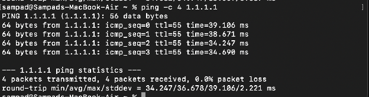

#### 2. Wireshark Capture under Filter `icmp || arp`
Applying `icmp || arp` captures both the ARP resolution and subsequent ICMP echo exchanges:

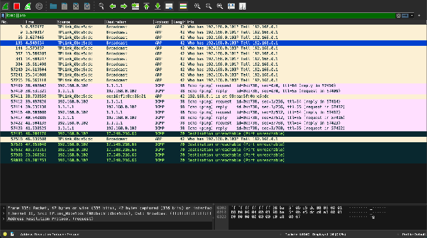

| Packet # | Timestamp (s) | Source IP | Destination IP | Protocol & Info | Seq # | TTL |
| :---: | :---: | :---: | :---: | :--- | :---: | :---: |
| **396** | 20.704524 | `192.168.0.102` | `1.1.1.1` | ICMP Echo Request (Type 8) | `seq=0/0` | 64 |
| **397** | 20.833800 | `1.1.1.1` | `192.168.0.102` | ICMP Echo Reply (Type 0) | `seq=0/0` | 55 |
| **398** | 21.799761 | `192.168.0.102` | `1.1.1.1` | ICMP Echo Request (Type 8) | `seq=1/256` | 64 |
| **399** | 21.838806 | `1.1.1.1` | `192.168.0.102` | ICMP Echo Reply (Type 0) | `seq=1/256` | 55 |
| **57411** | 38.733550 | `TPLink_0b:e5:dc` | `ee:16:f1:8c:06:01` | ARP: `192.168.0.1 is at ba:5f:0b:e5:dc` | — | — |
| **57412** | 39.497026 | `192.168.0.102` | `1.1.1.1` | ICMP Echo Request (Type 8) | `seq=1/256` | 64 |

* **ARP Broadcast Query:** Before transmitting to `1.1.1.1`, the host broadcasts an ARP Request (`Who has 192.168.0.1? Tell 192.168.0.102`) to resolve the default gateway.
* **ARP Unicast Reply:** The TP-Link router replies: `192.168.0.1 is at ba:5f:0b:e5:dc`.
* **ICMP Exchange:** Subsequent ICMP Echo Requests are framed directly to the gateway MAC address `ba:5f:0b:e5:dc`.
* **TTL Analysis:** Outgoing requests have $\text{TTL} = 64$. Received replies from `1.1.1.1` have $\text{TTL} = 55$. Since Cloudflare initializes at 64, the difference ($64 - 55 = 9$) indicates 9 intermediate routing hops.

---

### Question 2: Web Traffic Analysis (neverssl.com)

> **Problem Statement:** Generate some web traffic and:
> a. Find the list of different protocols that appear in the protocol column in the unfiltered packet-listing window.
> b. How long did it take from when the HTTP GET message was sent until the HTTP OK reply was received? (Evaluate using both relative seconds and Time-of-Day format).
> c. What is the Internet address of the website? What is the Internet address of your computer?
> d. Search back through your capture, and find an HTTP packet containing a GET command. Click on the packet in the Packet List Panel. Then expand the HTTP layer in the Packet Details Panel.
> e. Find out the value of the Host from the Packet Details Panel, within the GET command.

#### 2a: Protocol Column Breakdown in Unfiltered Capture

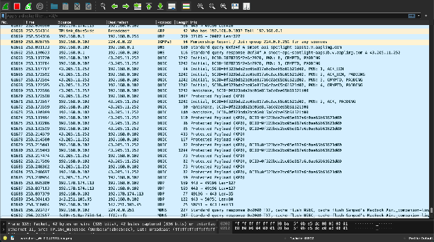

Active protocols identified in the unfiltered capture window:
1. **ARP (Address Resolution Protocol):** Resolves IP addresses to MAC hardware addresses.
2. **UDP (User Datagram Protocol):** Low-overhead, connectionless transport protocol.
3. **IGMPv3 (Internet Group Management Protocol Version 3):** Multicast group management.
4. **DNS (Domain Name System):** Resolves domain names to IP addresses.
5. **QUIC (Quick UDP Internet Connections):** Modern multiplexed transport protocol operating over UDP port 443 (HTTP/3).
6. **MDNS (Multicast DNS / Bonjour):** Local zero-configuration discovery on multicast IP `224.0.0.251`.
7. **TCP (Transmission Control Protocol):** Connection-oriented, reliable byte stream transport.
8. **HTTP (Hypertext Transfer Protocol):** Cleartext application-layer web protocol.
9. **TLSv1.2 / TLSv1.3 (Transport Layer Security):** Encrypted TCP payload protocol.
10. **ICMP (Internet Control Message Protocol):** Control and diagnostic reporting (`ping`).

#### 2b: Latency Analysis (HTTP GET to 200 OK $\Delta t$)
To generate unencrypted HTTP traffic, `curl http://neverssl.com/index.html` was executed from the terminal:

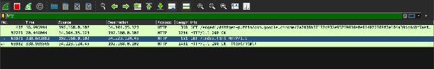

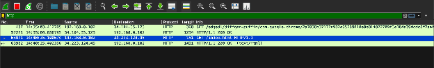

##### 1. Relative Time Calculation (Seconds from trace start):
* Request (Frame #63971): $t_{\text{GET}} = 338.603803\,\text{s}$
* Response (Frame #63982): $t_{\text{200 OK}} = 338.985365\,\text{s}$
$$\Delta t = 338.985365 - 338.603803 = \mathbf{0.381562\,\text{seconds}} \quad (\mathbf{381.562\,\text{ms}})$$

##### 2. Time-of-Day Calculation (`View > Time Display Format > Time of Day`):
* Request: $t_{\text{GET}} = 14:48:25.100674$
* Response: $t_{\text{200 OK}} = 14:48:25.482356$
$$\Delta t = 14:48:25.482356 - 14:48:25.100674 = \mathbf{0.381682\,\text{seconds}} \quad (\mathbf{381.682\,\text{ms}})$$

##### 3. Wireshark Internal Dissector Validation:
Under `[HTTP response ...]`, Wireshark explicitly reports:
$$\texttt{[Time since request: 0.381562 seconds]}$$

#### 2c: IP Address Identification (Host vs. Server)
* **Website IP (`neverssl.com`):** `34.223.124.45` (AWS EC2, Oregon)
* **Computer IP:** `192.168.0.102` (Class C private IPv4)

#### 2d & 2e: HTTP GET Packet Inspection & Host Parameter Value
Expanding the **Hypertext Transfer Protocol** layer of Frame #63971 in the Packet Details panel:

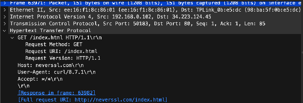

```http
Hypertext Transfer Protocol
    GET /index.html HTTP/1.1\r\n
        Request Method: GET
        Request URI: /index.html
        Request Version: HTTP/1.1
    Host: neverssl.com\r\n
    User-Agent: curl/8.7.1\r\n
    Accept: */*\r\n
    \r\n
    [Response in frame: 63982]
    [Full request URI: http://neverssl.com/index.html]
```

**Answer for 2e:** The value of the **Host** parameter is **`neverssl.com`**.

---

### Questions 3 & 4: Packet Bytes Inspection & Hexadecimal Host Value Mapping

> **Problem Statements:**
> * **Question 3:** Highlight the Hex and ASCII representations of the packet in the Packet Bytes Panel.
> * **Question 4:** Find out the first 4 bytes of the Hex value of the Host parameter from the Packet Bytes Panel.

Selecting `Host: neverssl.com\r\n` in Packet Details synchronizes with the Packet Bytes panel:

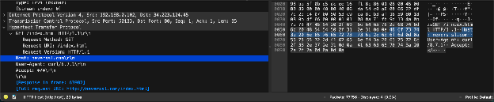

#### Synchronized Representation:
* **Highlighted Hexadecimal Bytes:**
  `48 6f 73 74 3a 20 6e 65 76 65 72 73 73 6c 2e 63 6f 6d 0d 0a`
* **Synchronized ASCII Rendering:**
  `Host: neverssl.com\r\n`

#### Question 4 Character-to-Hexadecimal Mapping:
| Parameter Character | Decimal ASCII Value | 8-Bit Binary | Hexadecimal Value |
| :---: | :---: | :---: | :---: |
| **`H`** | 72 | `01001000` | **`0x48`** |
| **`o`** | 111 | `01101111` | **`0x6f`** |
| **`s`** | 115 | `01110011` | **`0x73`** |
| **`t`** | 116 | `01110100` | **`0x74`** |

**Answer for Question 4:** The first 4 bytes of the Hex value of the Host parameter are:
$$\mathbf{48 \quad 6f \quad 73 \quad 74}$$

---

### Question 5: Following the Bidirectional TCP Stream

> **Problem Statement:** Filter packets with http, TCP, DNS and other protocols. Find out what those packets contain by following one of the conversations: select one of the packets, right-click, and select Follow > TCP Stream.

Applying filter `http || tcp || dns`, right-clicking Frame #63971, and selecting **Follow > TCP Stream** produces the dialog for **TCP Stream Index 40**:

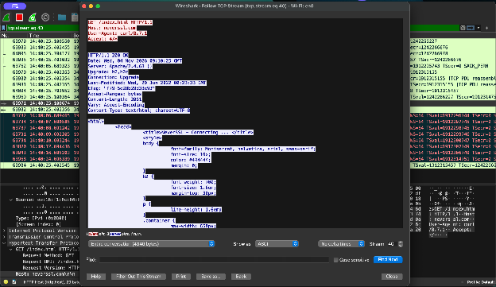

* **Client Request (Red Text — 85 bytes transmitted):**
  ```http
  GET /index.html HTTP/1.1
  Host: neverssl.com
  User-Agent: curl/8.7.1
  Accept: */*
  ```

* **Server Response (Blue Text — 4,261 bytes reassembled):**
  ```http
  HTTP/1.1 200 OK
  Date: Wed, 04 Nov 2026 09:18:25 GMT
  Server: Apache/2.4.60 ()
  Upgrade: h2,h2c
  Connection: Upgrade
  Last-Modified: Wed, 29 Jun 2022 00:23:33 GMT
  ETag: "f79-5e28b29d38e93"
  Accept-Ranges: bytes
  Content-Length: 3961
  Vary: Accept-Encoding
  Content-Type: text/html; charset=UTF-8

  <html>
      <head>
          <title>NeverSSL - Connecting ... </title>
          ...
  ```

---

### Question 6: Server HTTP Response Frame & Ethernet Layer Expansion

> **Problem Statement:** Search through your capture, and find an HTTP packet coming back from the server (TCP Source Port == 80). Expand the Ethernet layer in the Packet Details Panel.

Filtering by `tcp.srcport == 80` isolates all incoming traffic from port 80. Inspecting the HTTP 200 OK response from `neverssl.com` (Frame #63982) with the Ethernet II layer expanded:

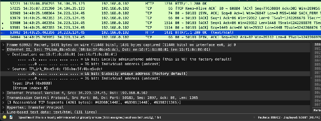

```
Frame 63982: Packet, 1431 bytes on wire (11448 bits) on interface en0
Ethernet II, Src: TPLink_0b:e5:dc (98:ba:5f:0b:e5:dc), Dst: ee:16:f1:8c:06:01 (ee:16:f1:8c:06:01)
    Destination: ee:16:f1:8c:06:01 (ee:16:f1:8c:06:01)
        .... ..1. .... .... .... .... = LG bit: Locally administered address (NOT factory default)
        .... ...0 .... .... .... .... = IG bit: Individual address (unicast)
    Source: TPLink_0b:e5:dc (98:ba:5f:0b:e5:dc)
        .... ..0. .... .... .... .... = LG bit: Globally unique address (factory default)
        .... ...0 .... .... .... .... = IG bit: Individual address (unicast)
    Type: IPv4 (0x0800)
```

---

### Question 7: NIC Manufacturers (Local PC vs. Remote Server)

> **Problem Statement:** What are the manufacturers of your PC’s Network Interface Card (NIC), and the server's NIC?

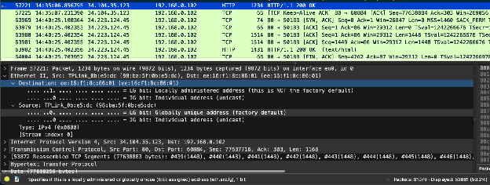

#### 1. PC's Network Interface Card (NIC) Manufacturer:
* **Hardware Device:** **Apple MacBook Air** (`sampad@Sampads-MacBook-Air`)
* **Physical Manufacturer:** **Apple, Inc.**
* **Captured Destination MAC:** `ee:16:f1:8c:06:01`
* **Why Wireshark Displays ``LG bit: Locally administered address``:**
  macOS uses **Private Wi-Fi Address** (MAC address randomization) by default. The operating system sets the **Locally Administered (LG) bit to 1** ($b_1 = 1$). Because this address is generated in software and is not in Apple's registered IEEE OUI database, Wireshark cannot resolve it to "Apple". The physical hardware remains an Apple NIC.

#### 2. Server's Incoming Frame Source MAC & Manufacturer:
* **Captured Source MAC:** `98:ba:5f:0b:e5:dc` (resolved as `TPLink_0b:e5:dc`)
* **Identified Manufacturer:** **TP-Link Technologies Co., Ltd.**
* **Layer 2 vs. Layer 3 Boundaries:**
  > Packets arriving from a remote web server over the Internet pass through intermediate Layer 3 routers. Layer 2 Ethernet frames are hop-by-hop protocols that terminate at each router interface. Therefore, the incoming Ethernet Source MAC belongs to the **local default gateway (TP-Link Wi-Fi router)**, NOT the physical remote web server in AWS.

```
+-------------------+                   +------------------+                   +-------------------+
|   Remote Server   |   L3 IP Packets   | Default Gateway  |   Local L2 Frame  |    MacBook Air    |
| 34.223.124.45:80  | ----------------> | (TP-Link Router) | ----------------> | 192.168.0.102     |
| (Physical NIC     |                   | MAC:             |  Src: TP-Link MAC | MAC:              |
|  Hidden by WAN)   |                   | 98:ba:5f:0b:e5:dc|  Dst: Apple MAC   | ee:16:f1:8c:06:01 |
+-------------------+                   +------------------+                   +-------------------+
```

---

### Question 8: Organizationally Unique Identifiers (OUIs) in Hexadecimal

> **Problem Statement:** What are the Hex values (shown in the raw bytes panel) of the two NICs Manufacturers OUIs?

An **Organizationally Unique Identifier (OUI)** consists of the first 3 bytes (24 bits / 6 hex digits) of a 48-bit MAC address:

| MAC Address Details Pane | Raw Bytes Panel Offset 0x0000 |
| :---: | :---: |
| 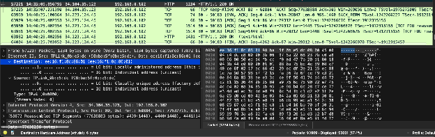 | 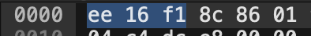 |

At byte offset `0x0000` of the Ethernet frame:
```
0000  ee 16 f1 8c 06 01  98 ba 5f 0b e5 dc  08 00 ...
```

#### Exact OUI Hexadecimal Values:
1. **Source NIC (Default Gateway / TP-Link Router):**
   * Full MAC Address: `98:ba:5f:0b:e5:dc`
   * **OUI Hex Value:** **`98:ba:5f`** (raw bytes: `98 ba 5f`)
   * Vendor: **TP-Link Technologies Co., Ltd.**
   * Status: Globally unique, factory default ($b_1 = 0$, $b_0 = 0$).

2. **Destination NIC (Local MacBook Air Client):**
   * Full MAC Address: `ee:16:f1:8c:06:01`
   * **OUI / Prefix Hex Value:** **`ee:16:f1`** (raw bytes: `ee 16 f1`)
   * Status: Locally administered address ($b_1 = 1$, $b_0 = 0$) generated by macOS Private Wi-Fi MAC randomization.

---

### Question 9: Protocol Hierarchy Statistics (TCP vs. UDP Breakdown)

> **Problem Statement:** Find the following statistics:
> a. What percentage of packets in your capture are TCP, and give an example of the higher level protocol which uses TCP?
> b. What percentage of packets in your capture are UDP, and give an example of the higher level protocol which uses UDP?

Opening **Statistics > Protocol Hierarchy** with all display filters cleared reveals the protocol distribution across all **97,552 captured frames**:

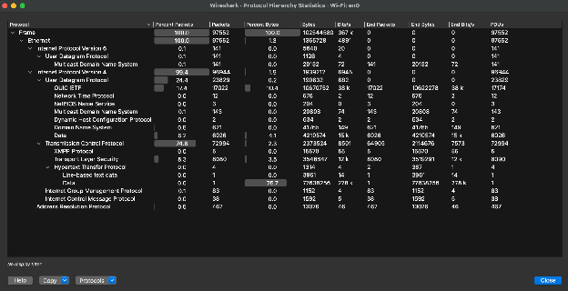

| Protocol Layer / Node | % Packets | Packet Count | % Bytes | Total Bytes | Notes / Examples |
| :--- | :---: | :---: | :---: | :---: | :--- |
| **Frame (Total Capture)** | **100.0%** | **97,552** | **100.0%** | **102,544,580** | Complete capture corpus |
| $\hookrightarrow$ **Ethernet II** | 100.0% | 97,552 | 1.3% | 1,365,728 | Data Link framing |
| $\quad\hookrightarrow$ **IPv6** | 0.1% | 141 | 0.0% | 5,640 | Next-generation IP |
| $\quad\quad\hookrightarrow$ **UDP (IPv6)** | 0.1% | 141 | 0.0% | 1,128 | mDNS over IPv6 |
| $\quad\hookrightarrow$ **IPv4** | 99.4% | 96,944 | 1.9% | 1,939,212 | Standard Internet traffic |
| $\quad\quad\hookrightarrow$ **TCP** | **74.8%** | **72,994** | 2.3% | 2,373,524 | Reliable byte streams |
| $\quad\quad\quad\hookrightarrow$ TLS | 8.3% | 8,080 | 3.5% | 3,546,847 | HTTPS encryption |
| $\quad\quad\quad\hookrightarrow$ HTTP | 0.0% | 4 | 0.0% | 1,314 | Cleartext web requests |
| $\quad\quad\quad\hookrightarrow$ Data Payload | 0.0% | 1 | 75.7% | 77,638,256 | Stream payload data |
| $\quad\quad\hookrightarrow$ **UDP (IPv4)** | **24.4%** | **23,829** | 0.2% | 190,632 | Connectionless transport |
| $\quad\quad\quad\hookrightarrow$ QUIC IETF | 17.4% | 17,022 | 10.4% | 10,670,752 | HTTP/3 over UDP |
| $\quad\quad\quad\hookrightarrow$ DNS | 0.6% | 621 | 0.0% | 41,765 | Domain queries |
| $\quad\quad\quad\hookrightarrow$ mDNS | 0.1% | 143 | 0.0% | 20,808 | Apple Bonjour discovery |
| $\quad\quad\quad\hookrightarrow$ NTP | 0.0% | 12 | 0.0% | 576 | Time synchronization |
| $\quad\quad\quad\hookrightarrow$ DHCP | 0.0% | 2 | 0.0% | 634 | IP configuration |
| $\quad\quad\hookrightarrow$ IGMP | 0.1% | 83 | 0.0% | 1,152 | Multicast management |
| $\quad\quad\hookrightarrow$ ICMP | 0.0% | 38 | 0.0% | 1,592 | Ping diagnostics |
| $\quad\hookrightarrow$ **ARP** | 0.5% | 467 | 0.0% | 13,076 | Address resolution |

#### 1. TCP Statistics (Question 9a):
* **Percentage of Packets:** **`74.8%`** (Absolute count: **`72,994 packets`**).
* **Higher-Level Protocols Using TCP:** HTTP, HTTPS/TLS, SSH, FTP, XMPP.

#### 2. UDP Statistics (Question 9b):
* **Percentage of Packets:**
  * Under IPv4: **`24.4%`** (`23,829 packets`)
  * Under IPv6: **`0.1%`** (`141 packets`)
  * **Total UDP Packets:** **`24.57%`** (**`23,970 packets`**).
* **Higher-Level Protocols Using UDP:** DNS, QUIC (HTTP/3), mDNS, DHCP, NTP, RTP (VoIP).

---

### Question 10: Traffic Flow Graph Sequence Analysis

> **Problem Statement:** Find the traffic flow. Select the Statistics > Flow Graph menu option. Choose General Flow and Network Source options, and click the OK button.

The Wireshark **Flow Graph** displays chronological ladder diagrams tracing packet interactions between network endpoints:

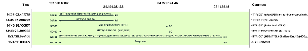

#### Chronological Transaction Walkthrough:
1. **Google Puffin Update Flow:**
   * `14:35:03.412785`: `192.168.0.102:60884` sends `HTTP GET /edgedl/diffgen-puffin/...` to `34.104.35.123:80`.
   * `14:35:06.856795`: `34.104.35.123:80` responds with `HTTP/1.1 200 OK`.
2. **Target NeverSSL Web Flow:**
   * `14:40:25.100674`: `192.168.0.102:50183` sends `HTTP GET /index.html HTTP/1.1` to `34.223.124.45:80`.
   * `14:40:25.402356`: `34.223.124.45:80` responds with `HTTP/1.1 200 OK (text/html)`.
3. **OCSP Certificate Validation Flow:**
   * `15:17:10.997100`: `192.168.0.102:61049` issues an OCSP status check to Akamai CDN server `23.11.38.161:80`.
   * `15:17:11.033177`: `23.11.38.161:80` returns the `OCSP: Response`.

---

## 5. In-Depth Technical Analysis & Discussion

### 5.1 Layer 2 vs. Layer 3 Routing Boundaries
A critical insight demonstrated in Question 7 is the separation of responsibilities between Layer 2 (Data Link) and Layer 3 (Network):
* **Layer 3 (IP) is End-to-End:** Source and destination IP addresses (`192.168.0.102` and `34.223.124.45`) persist across all intermediate hops.
* **Layer 2 (Ethernet) is Hop-by-Hop:** MAC addresses are meaningful only within a local broadcast domain. When the gateway router forwards a packet to the client, it replaces the WAN frame header with a local 802.11 header using its own Wi-Fi MAC (`98:ba:5f:0b:e5:dc`). The remote server's physical NIC is never visible on the local segment.

### 5.2 Operating System MAC Address Randomization (LG Bit)
Modern operating systems (macOS, iOS, Android, Windows 11) implement MAC address randomization on wireless networks to mitigate physical tracking:
* **Bit 0 ($b_0$, I/G):** `0` = Individual (Unicast), `1` = Group (Multicast).
* **Bit 1 ($b_1$, U/L):** `0` = Universally Administered (IEEE OUI), `1` = Locally Administered.

For the client address `ee:16:f1:8c:06:01`:
$$\texttt{0xEE} = 1110\,1110_2 \implies b_1 = 1 \quad (\text{Locally Administered})$$
This proves that the operating system deliberately generated a synthetic MAC address with $b_1 = 1$, explaining why Wireshark's IEEE OUI database cannot match the address to Apple Inc.

### 5.3 Transport Layer Shift: QUIC and HTTP/3 vs. Traditional TCP
In legacy network environments, TCP accounted for $>95\%$ of transport traffic. In this modern capture:
* **QUIC represents $17.4\%$ of all captured packets** ($17,022$ packets).
* This illustrates the real-world deployment of HTTP/3 over QUIC (RFC 9000), which runs on UDP port 443 to eliminate TCP head-of-line blocking and speed up handshakes across modern web platforms.

---

## 6. Laboratory Comments & Learning Reflections

### Evaluation of the Lab Assignment
This assignment offered valuable practical reinforcement of core networking protocols. Analyzing live packet traces directly connects theoretical lecture material with the actual byte streams transmitted across physical network hardware.

### Key Learnings:
1. **Multi-Layer Encapsulation:** Traced packet construction through Ethernet, IPv4, TCP, and HTTP.
2. **Accurate Delay Measurement:** Measured round-trip latencies ($\Delta t = 381.562\text{ ms}$) directly from packet timestamps.
3. **Gateway Routing Realities:** Verified why remote server MAC addresses are replaced by gateway addresses at Layer 3 boundaries.
4. **Hardware & Privacy Mechanics:** Analyzed bit-level MAC address randomization and IEEE OUI lookups.
5. **Modern Protocol Mix:** Observed significant QUIC/UDP traffic alongside traditional TCP.

### Difficulty Assessment & Suggestions:
* **Difficulty:** Well-calibrated. Capturing and filtering is straightforward, while questions on gateway MAC replacement and MAC randomization require solid conceptual understanding.
* **Suggested Enhancement:** Incorporating TLS pre-master secret key logging (`SSLKEYLOGFILE`) in future labs would allow students to decrypt and inspect HTTPS traffic for educational diagnostics.

---

## 7. References

1. **Jadavpur University:** CSE/PC/B/S/314 Computer Networks Lab Guidelines (`Report_guidelines.pdf`).
2. **Behrouz A. Forouzan:** *Data Communications and Networking*, 5th Edition, McGraw-Hill, 2013 (Chapters on Data Link Layer, ARP, IP, TCP/UDP, HTTP).
3. **James F. Kurose and Keith W. Ross:** *Computer Networking: A Top-Down Approach*, 8th Edition, Pearson, 2021 (Chapters 1–5: Layered Architecture, Wireshark Lab Modules).
4. **W. Richard Stevens:** *TCP/IP Illustrated, Volume 1: The Protocols*, Addison-Wesley.
5. **Wireshark Foundation:** *Wireshark User's Guide*, [https://www.wireshark.org/docs/wsug_html_chunked/](https://www.wireshark.org/docs/wsug_html_chunked/).
6. **IETF RFCs:** RFC 792 (ICMP), RFC 826 (ARP), RFC 2616 / RFC 7230 (HTTP/1.1), RFC 9000 (QUIC).
7. **IEEE Standards Association:** IEEE 802.3 Working Group & Guidelines for EUI-48 / OUI Identifiers.
8. **Source Code Repository:** [https://github.com/Sampad2006/CN-Lab-Assignments](https://github.com/Sampad2006/CN-Lab-Assignments).
