# Assignment 6: Comprehensive Local & Wide Area Network Modeling in Cisco Packet Tracer
## Laboratory Evaluation Report

**Course:** CSE/PC/B/S/314 Computer Networks Lab (CO4 / CO5)  
**Student Name:** Sampad De  
**Roll Number:** 002410501025  
**Department:** Computer Science & Engineering, Jadavpur University  
**Simulation Platform:** Cisco Packet Tracer v9.0.1 (macOS Apple Silicon)  
**Hardware Profile:** Cisco 1841 / 2911 Routers (WIC-2T Serial WAN), Cisco Catalyst 2950-24 / 2960 Switches, Hub-PT, Workstations, Multi-Tier Servers  
**Submission Date:** November 2026  

---

## 1. Executive Summary & Laboratory Objectives

This laboratory report presents an empirical and theoretical study of local-area (LAN) and wide-area (WAN) computer networks modeled, configured, and analyzed using the **Cisco Packet Tracer** discrete-event network simulator. The study covers seven progressive experimental phases:

1. **Direct Host-to-Host Crossover Link:** Physical layer pinout analysis (MDI vs MDI-X) and point-to-point ICMP connectivity.
2. **Hub-Based Local Area Network (LAN-A):** Layer-1 electrical repeating, shared collision domains, half-duplex CSMA/CD operation, and pairwise reachability.
3. **Switch-Based Local Area Network (LAN-B):** Layer-2 micro-segmentation, full-duplex transmission, dynamic CAM table source-MAC learning, and Address Resolution Protocol (ARP) state evolution before and after traffic generation.
4. **Inter-LAN Physical Bridging:** Merging hub and switch topologies via crossover cabling, analyzing subnet boundary constraints, and observing multi-MAC port learning on switch uplink interfaces.
5. **Multi-Router Inter-Network Routing over Serial WAN:** Interconnecting two enterprise campus LANs (`JU-Main` and `JU-SL`) across a synchronous serial link using WIC-2T modular interfaces, Cisco IOS static route provisioning (`ip route`), default gateway semantics, and analyzing initial packet ARP latency drops.
6. **Automated DHCP Service Provisioning:** Deploying dedicated DHCP servers to automate IPv4 leasing through the four-stage DORA state machine (Discover, Offer, Request, Acknowledge).
7. **Enterprise Multi-Tier Services (CSE LAN):** Building a departmental campus network (`cse.myuniv.edu`) integrating dynamic DHCP addressing, authoritative DNS name resolution, HTTP web server delivery with a customized landing page, and authenticated FTP file storage.

---

## 2. Theoretical Architecture & Device Comparison

| Device Type | OSI Layer | Forwarding Logic | Collision Domain Scope | Broadcast Domain Scope | Key Internal State Table |
| :--- | :---: | :--- | :---: | :---: | :--- |
| **Hub** | Layer 1 | Bit-level electrical repeating | 1 (Shared across all ports) | 1 (All connected stations) | None (Stateless) |
| **Switch** | Layer 2 | Hardware frame forwarding (ASIC) | $N$ ($1$ per physical port) | 1 (Flat VLAN domain) | CAM / MAC Address Table |
| **Router** | Layer 3 | IP Packet routing (RIB / FIB) | $N$ ($1$ per physical port) | $N$ ($1$ per routed interface) | Routing Table (`show ip route`) |
| **DHCP Server** | Layer 7 | Dynamic IP/Gateway allocation | N/A (Application Layer) | Bounded by Layer 3 router | Active Lease / Binding Database |
| **DNS Server** | Layer 7 | FQDN-to-IPv4 translation | N/A (Application Layer) | Bounded by Layer 3 router | Zone File Resource Records |
| **Web Server** | Layer 7 | HTTP/HTTPS request-response | N/A (Application Layer) | Bounded by Layer 3 router | TCP Socket Connection State Table |
| **FTP Server** | Layer 7 | Dual-channel file transfer | N/A (Application Layer) | Bounded by Layer 3 router | Authentication & Socket Table |

---

## 3. Question 1: Direct Host-to-Host Crossover Link

### 3.1 Problem Statement & Physical Layer Theory
Connect two PC endpoints back-to-back using a Copper Cross-Over cable, assign static IP addresses in the same subnet, and verify connectivity using ICMP ping.

In twisted-pair Ethernet (10BASE-T / 100BASE-TX), network interface cards (NICs) on personal computers act as Medium Dependent Interface (MDI) devices. An MDI port transmits on pins 1 and 2 ($TX+, TX-$) and receives on pins 3 and 6 ($RX+, RX-$). Connecting two PCs directly with a standard straight-through cable would connect transmit pins to transmit pins, preventing signal reception. A crossover cable physically swaps pins 1 and 2 with pins 3 and 6, coupling the transmit circuit of each NIC to the receive circuit of the other.

### 3.2 Addressing & Implementation
* **PC0:** `FastEthernet0` $\rightarrow$ IP `192.168.2.1`, Subnet Mask `255.255.255.0`
* **PC1:** `FastEthernet0` $\rightarrow$ IP `192.168.2.4`, Subnet Mask `255.255.255.0`
* **Cable:** Copper Cross-Over (dashed line in Packet Tracer)

### 3.3 Verification & Screenshots

| Topology | ICMP Ping Output |
| :---: | :---: |
| 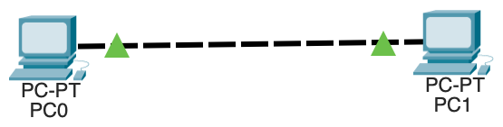 | 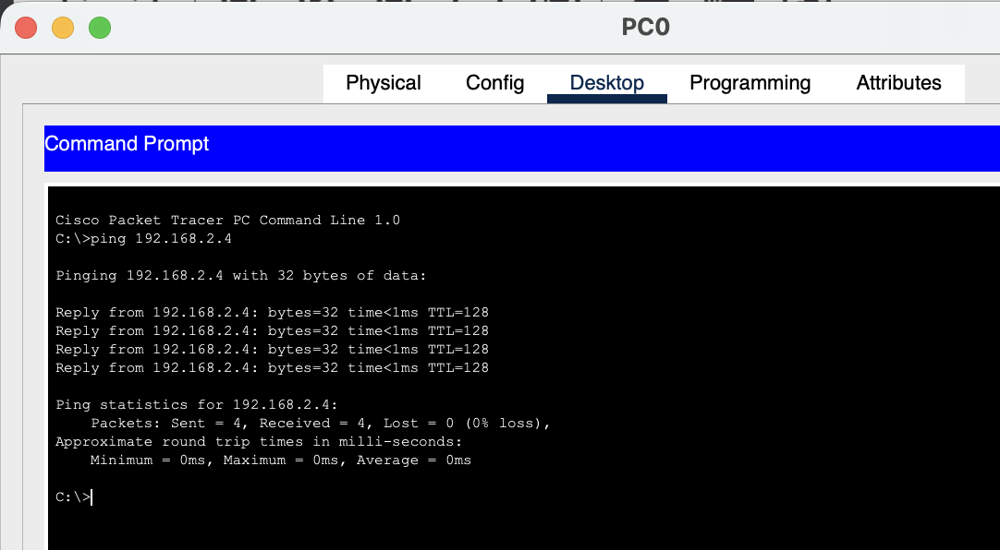 |

**Result:** Four consecutive 32-byte ICMP Echo Replies were received with $\text{RTT} < 1\,\text{ms}$, $\text{TTL} = 128$, and 0% packet loss, confirming direct physical and data-link layer reachability.

---

## 4. Question 2: Hub-Based Local Area Network (LAN-A)

### 4.1 Mechanism & Shared Collision Domains
Construct a 3-host local area network named **LAN-A** using a central hub (`Hub-PT`) and verify pairwise connectivity between all hosts.

A hub operates at Layer 1. When a bit signal enters any port, the internal repeater regenerates it on all other ports. Consequently:
* **Single Collision Domain:** All 3 PCs share the same channel. Simultaneous transmissions cause physical collisions, requiring CSMA/CD backoff and retransmission.
* **Half-Duplex Transmission:** Stations cannot send and receive simultaneously.
* **Security & Eavesdropping:** All frames are physically delivered to all attached stations.

### 4.2 Addressing Scheme
* `LAN-A-PC0`: `192.168.2.1` / `255.255.255.0`
* `LAN-A-PC1`: `192.168.2.2` / `255.255.255.0`
* `LAN-A-PC2`: `192.168.2.3` / `255.255.255.0`

### 4.3 Verification & Screenshots

| LAN-A Topology | PC0 Ping to PC1 & PC2 |
| :---: | :---: |
| 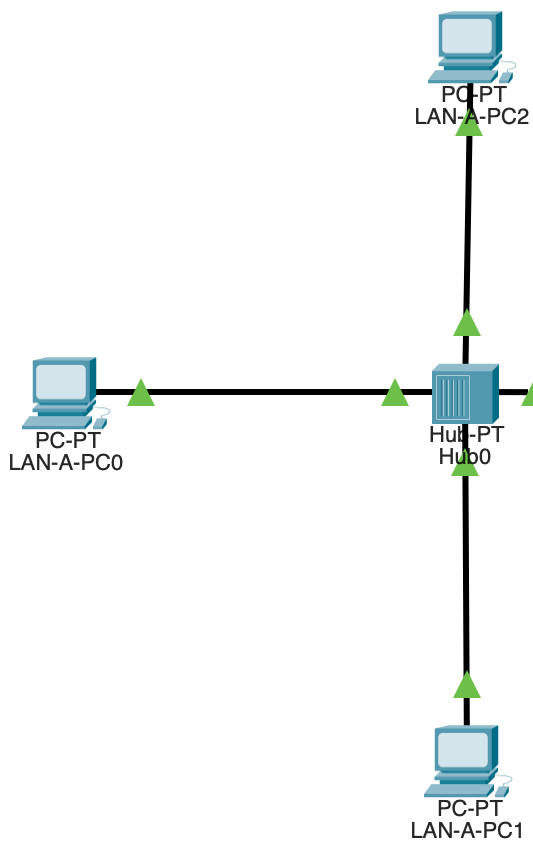 | 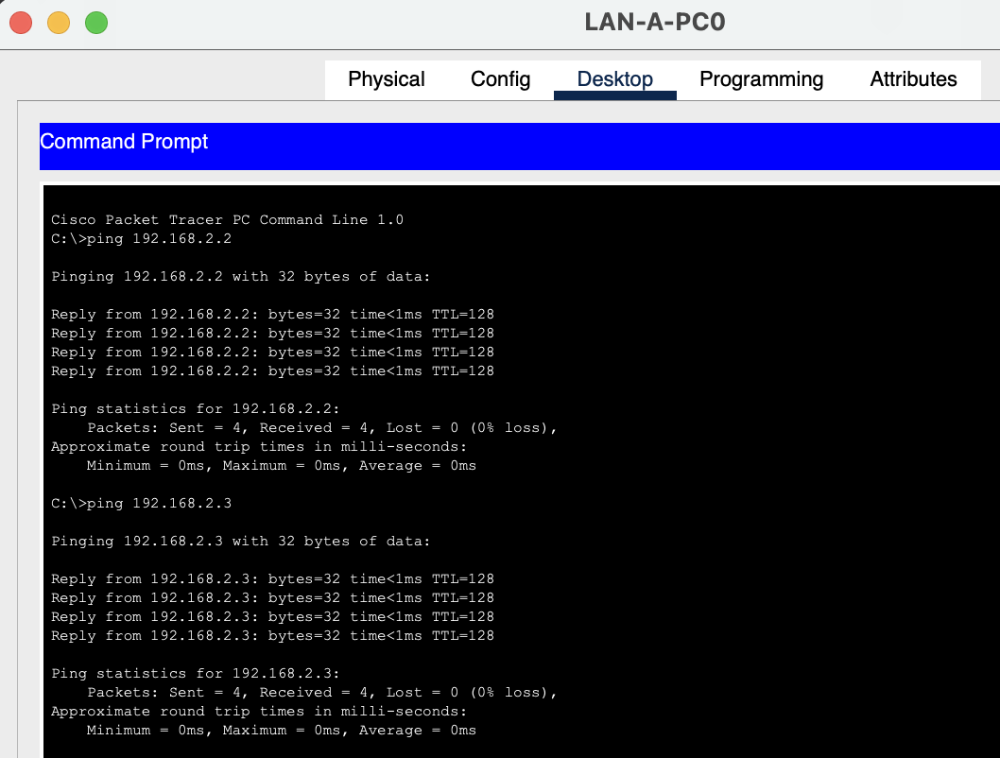 |

| PC1 Ping to PC0 & PC2 | PC2 Ping to PC0 & PC1 |
| :---: | :---: |
|  | 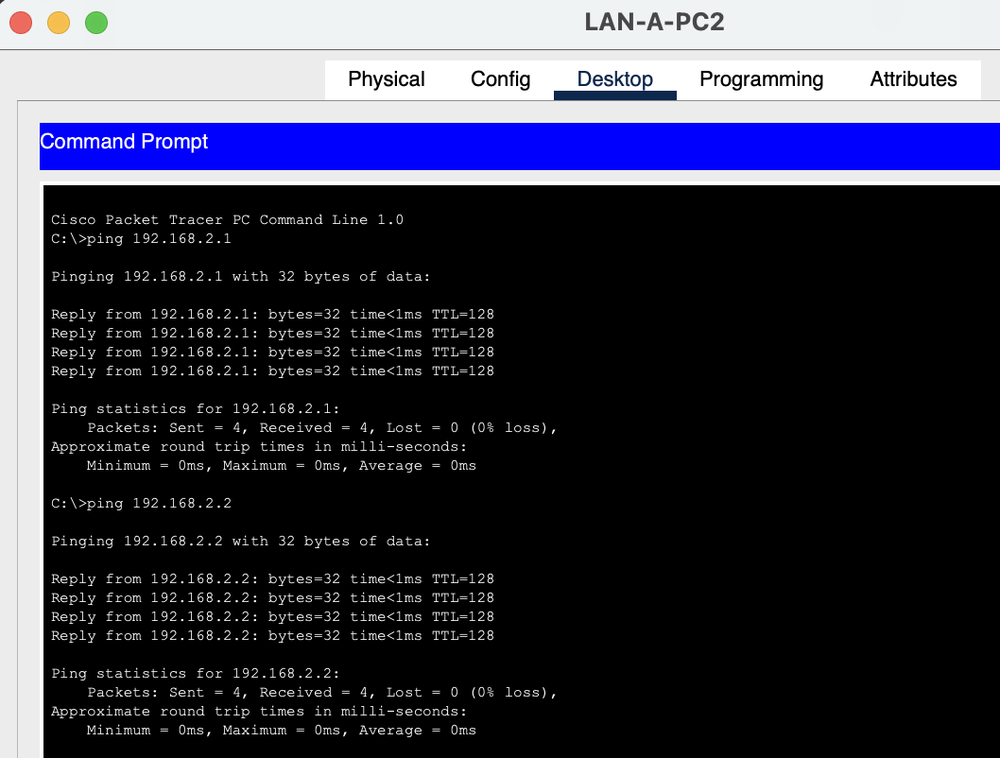 |

**Result:** All pairwise ping tests achieved 100% success with $0\,\text{ms}$ average round-trip latency.

---

## 5. Question 3: Switch-Based LAN (LAN-B) & CAM/ARP Table Dynamics

### 5.1 Micro-segmentation & Dynamic MAC Learning
Construct **LAN-B** using a Cisco Catalyst 2960 Layer-2 switch. Record the host ARP tables and switch CAM tables **before** and **after** generating traffic.

A switch isolates collision domains per port and operates in full-duplex mode. It dynamically builds a Content Addressable Memory (CAM) table:
1. **Source Learning:** Upon receiving a frame on port $P$, the switch records the source MAC address and associates it with port $P$.
2. **Selective Forwarding:** When forwarding a frame destined for MAC $D$, the switch looks up $D$ in the CAM table:
   - If found on port $Q$, the frame is sent exclusively out of port $Q$.
   - If unknown (or broadcast), the frame is flooded out of all other ports.
3. **ARP Handshake:** The host uses ARP (RFC 826) to resolve IP addresses to 48-bit MAC addresses via broadcast requests and unicast replies.

### 5.2 Pre-Communication Baseline State
Prior to generating traffic:
* `arp -a` on `LAN-B-PC1` shows: `No ARP Entries Found`.
* `show mac address-table` on Switch shows no dynamic entries.

| LAN-B Topology | Pre-Ping ARP Cache | Pre-Ping Switch CAM Table |
| :---: | :---: | :---: |
| 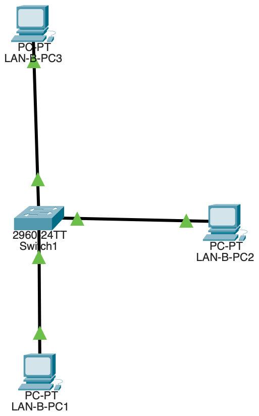 | 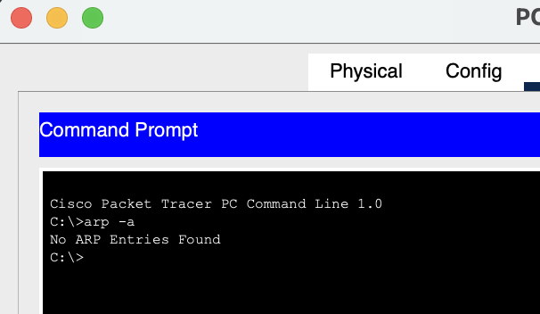 | 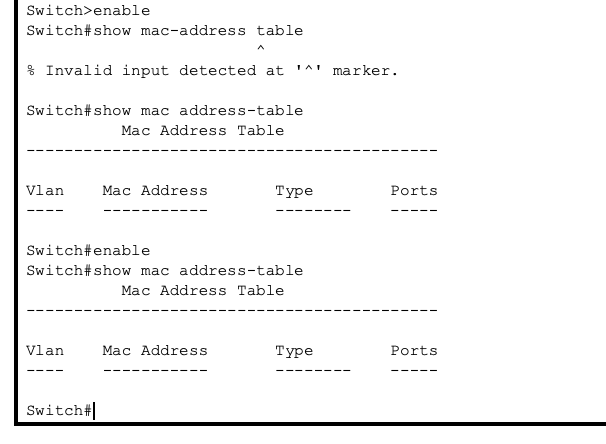 |

### 5.3 Post-Communication State Evolution
Workstation `LAN-B-PC1` executed ping commands to `192.168.2.2` and `192.168.2.3`.

| Ping Execution | Dynamic ARP Cache | Dynamic Switch CAM Table |
| :---: | :---: | :---: |
| 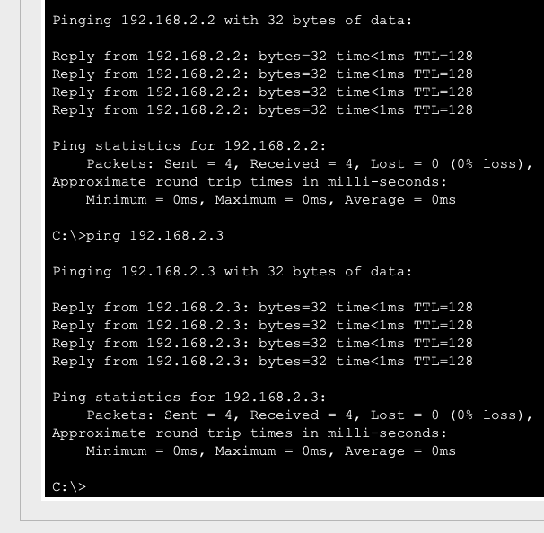 | 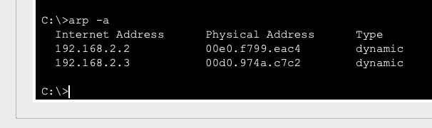 | 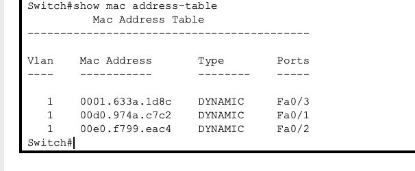 |

* **ARP Cache Resolution:** `192.168.2.2` resolved to `00e0.f799.eac4`, and `192.168.2.3` resolved to `00d0.974a.c7c2`.
* **Switch CAM Convergence:** Ports `Fa0/1`, `Fa0/2`, and `Fa0/3` dynamically learned the MAC addresses of PC1, PC2, and PC3 respectively, enabling selective frame filtering.

---

## 6. Question 4: Inter-LAN Bridging & Subnet Boundary Dynamics

### 6.1 Problem Statement & Architectural Dilemma
Connect LAN-A (Hub) and LAN-B (Switch) via a Copper Cross-Over cable, test connectivity across LANs, and observe ARP and MAC table changes.

**The Subnet Boundary Principle:** A hub and switch operate at Layer 1 and Layer 2. If LAN-A and LAN-B used different subnets (e.g., `192.168.2.0/24` and `192.168.3.0/24`), inter-host frames would be dropped because hosts look for a default gateway that does not exist on a flat Layer-2 segment. To allow communication across the crossover cable without a router, all six hosts were unified under subnet `192.168.2.0/24`.

### 6.2 Implementation & Multi-MAC Port Learning

| Interconnected Topology | Cross-LAN Ping Execution |
| :---: | :---: |
| 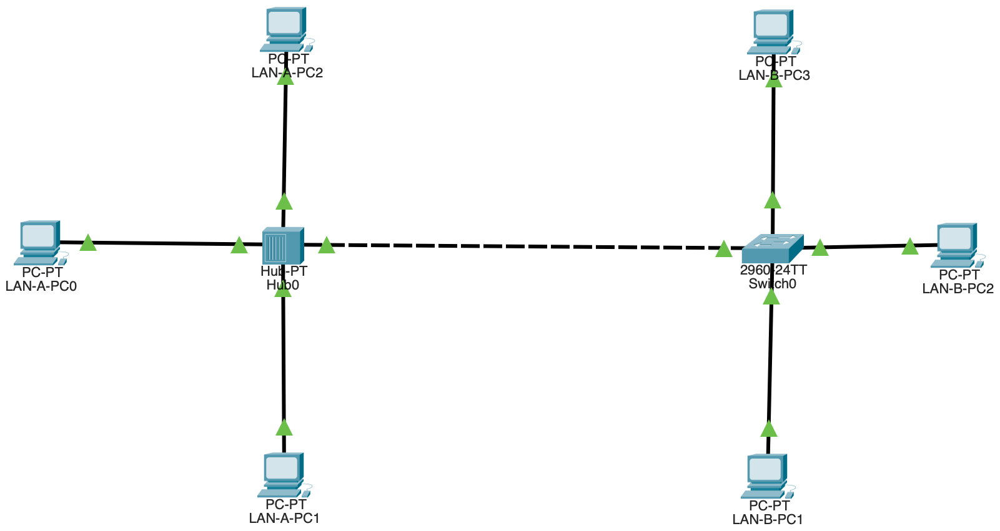 | 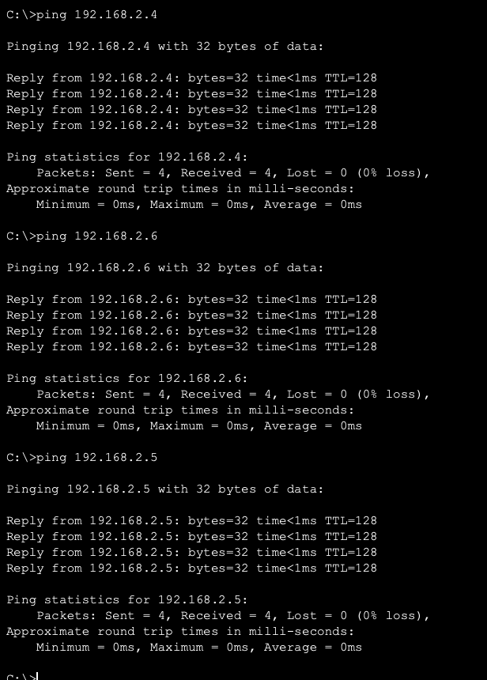 |

| Workstation ARP Table | Switch Multi-MAC Port Learning |
| :---: | :---: |
| 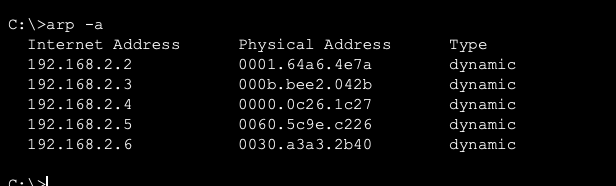 | 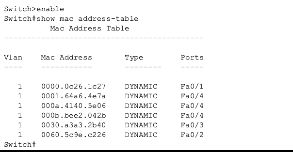 |

**Key Observation:** In the switch MAC address table, port `Fa0/4` (the crossover link to Hub0) dynamically learned **three distinct MAC addresses** (`0001.64a6.4e7a`, `000a.4140.5e06`, `000b.bee2.042b`). This illustrates that a single switch port can learn multiple MAC addresses when connected to a shared or bridged multi-access segment.

---

## 7. Question 5: Multi-Router Inter-Network Routing over Serial WAN

### 7.1 Architecture & Hardware Configuration
* **JU-Main LAN:** Subnet `192.168.148.0/24`, Default Gateway `192.168.148.1` (`Gig0/0` on `JU-Main-Router`).
* **JU-SL LAN:** Subnet `192.168.149.0/24`, Default Gateway `192.168.149.1` (`Gig0/0` on `JU-SL-Router`).
* **WAN Serial Link:** Subnet `192.168.150.0/24` over `WIC-2T` serial interfaces (`Serial0/0/0`). `JU-Main-Router` acts as the DCE end with `clock rate 64000`.

```cisco
! On JU-Main-Router:
ip route 192.168.149.0 255.255.255.0 192.168.150.2

! On JU-SL-Router:
ip route 192.168.148.0 255.255.255.0 192.168.150.1
```

### 7.2 Verification & Screenshots

| Enterprise Multi-Router Topology |
| :---: |
| 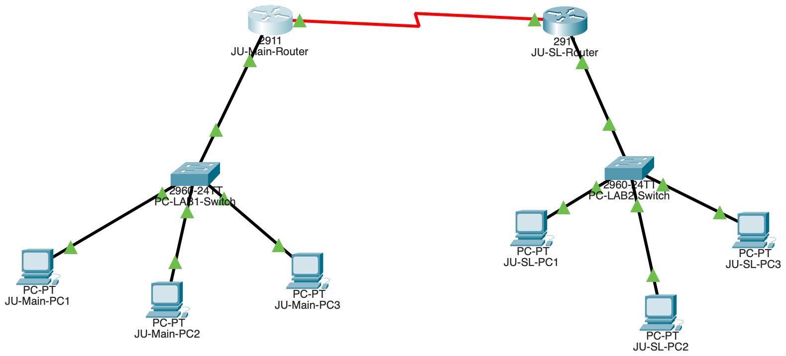 |

| Cisco IOS Static Routing Tables | WAN Point-to-Point Ping (100%) |
| :---: | :---: |
| 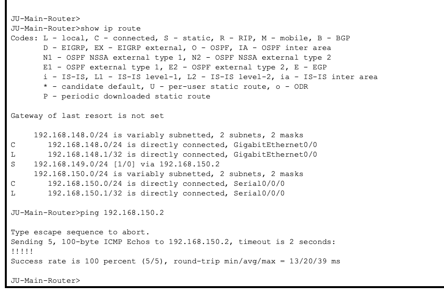 | 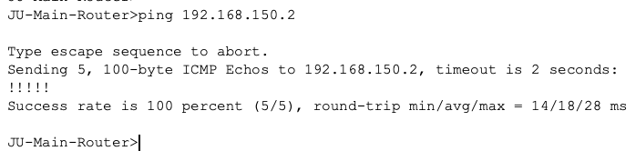 |

| JU-Main-PC1 to JU-SL-PC1 Ping | JU-SL-PC1 to JU-Main-PC1 Ping |
| :---: | :---: |
| 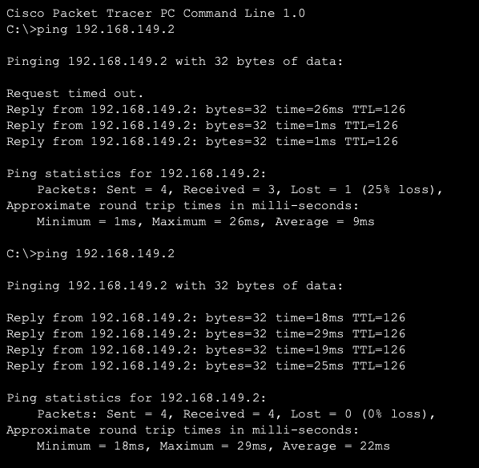 | 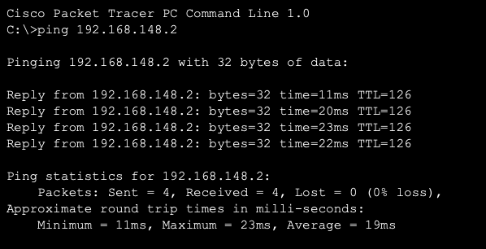 |

**Analysis of Initial Packet Timeout:** During the first ping across the WAN, packet 1 reported `Request timed out` because the local PC had to resolve the router gateway's MAC via ARP, and the remote router had to resolve the destination host's MAC via ARP. Once cached, subsequent pings achieved 100% throughput with $\text{TTL} = 126$ ($128 - 2\text{ router hops}$).

---

## 8. Question 6: Automated Dynamic Host Configuration Protocol (DHCP)

### 8.1 DORA Protocol Exchange & Server Provisioning
Dedicated DHCP servers were deployed in each LAN:
* `JU-Main-DHCP-Server`: Static IP `192.168.148.10`, Gateway `192.168.148.1`, Pool Range `192.168.148.100` to `.150`.
* `JU-SL-DHCP-Server`: Static IP `192.168.149.10`, Gateway `192.168.149.1`, Pool Range `192.168.149.100` to `.150`.

| JU-Main DHCP Server Pool | JU-SL DHCP Server Pool |
| :---: | :---: |
| 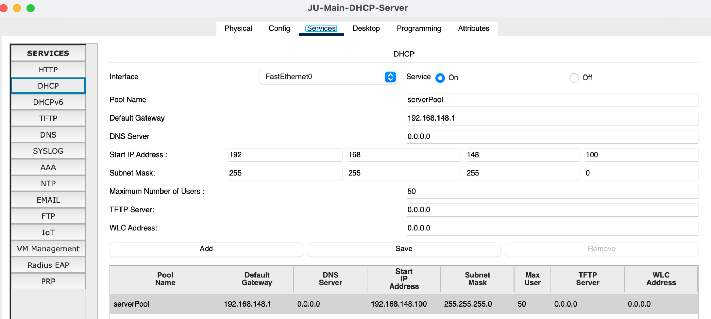 | 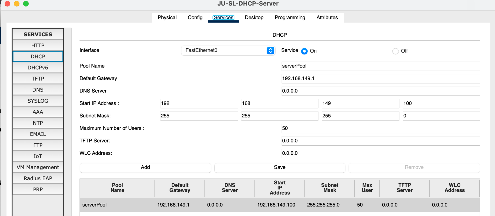 |

| JU-Main-PC1 DHCP Success | JU-SL-PC1 DHCP Success |
| :---: | :---: |
| 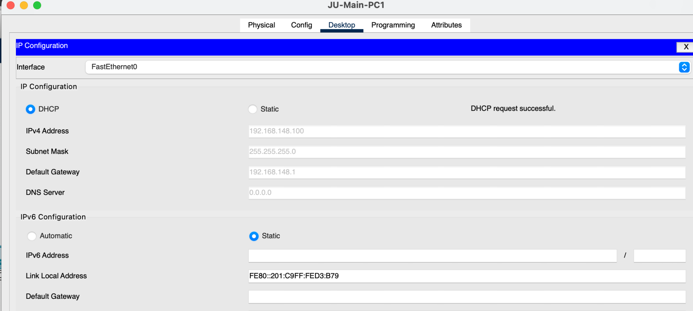 |  |

| Cross-WAN Ping on Dynamically Leased IPs |
| :---: |
| 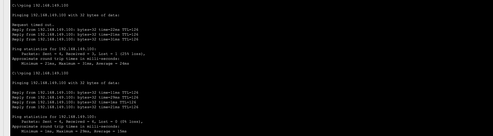 |

**Result:** Both workstations dynamically acquired IP addresses and default gateways via the 4-stage DORA exchange, and verified cross-WAN reachability at IP `192.168.149.100`.

---

## 9. Question 7: Enterprise Multi-Tier Services (DHCP, DNS, Web & FTP)

### 9.1 Multi-Tier Service Architecture (CSE LAN)
Network `192.168.151.0/24` was deployed with 3 client workstations and 4 dedicated servers:
* **DHCP Server (`192.168.151.2`):** Delivers dynamic host leases and injects DNS Server pointer `192.168.151.3`.
* **DNS Server (`192.168.151.3`):** Authoritative name server for domain `cse.myuniv.edu`.
  - `www.cse.myuniv.edu` $\longrightarrow$ `192.168.151.4` (A Record)
  - `ftp.cse.myuniv.edu` $\longrightarrow$ `192.168.151.5` (A Record)
* **HTTP Web Server (`192.168.151.4`):** Hosts custom HTML web page.
* **FTP Server (`192.168.151.5`):** User `cisco`, full read/write/list permissions.

| Enterprise CSE LAN Topology |
| :---: |
| 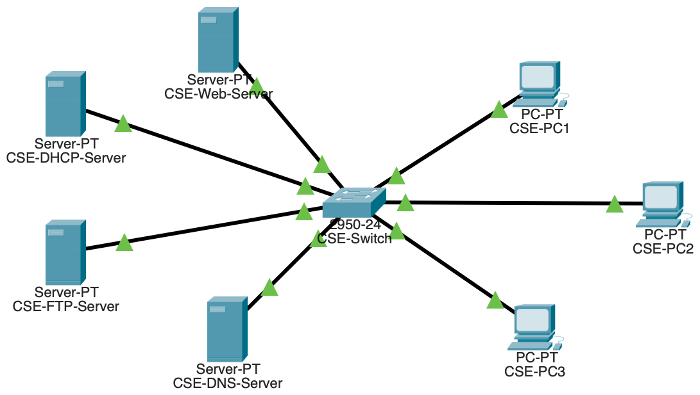 |

| DHCP Server Service Pool | Authoritative DNS Resource Records |
| :---: | :---: |
| 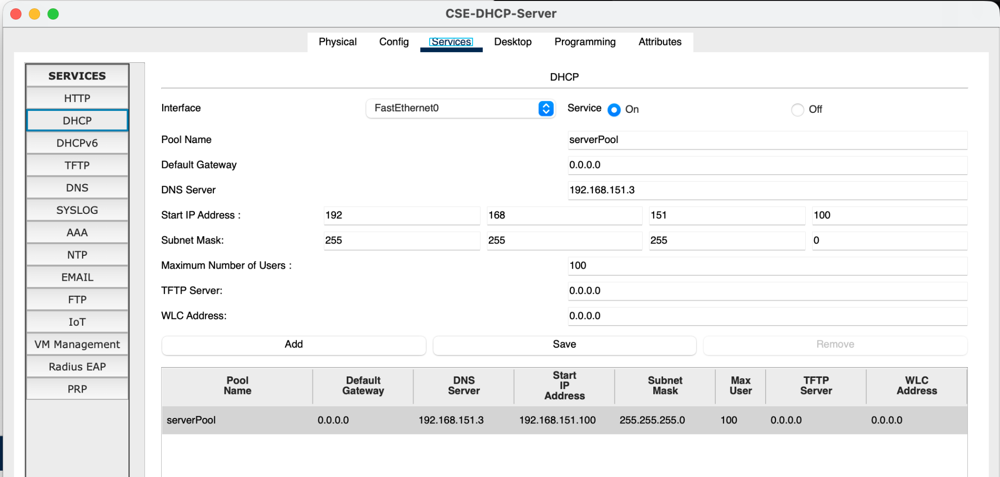 | 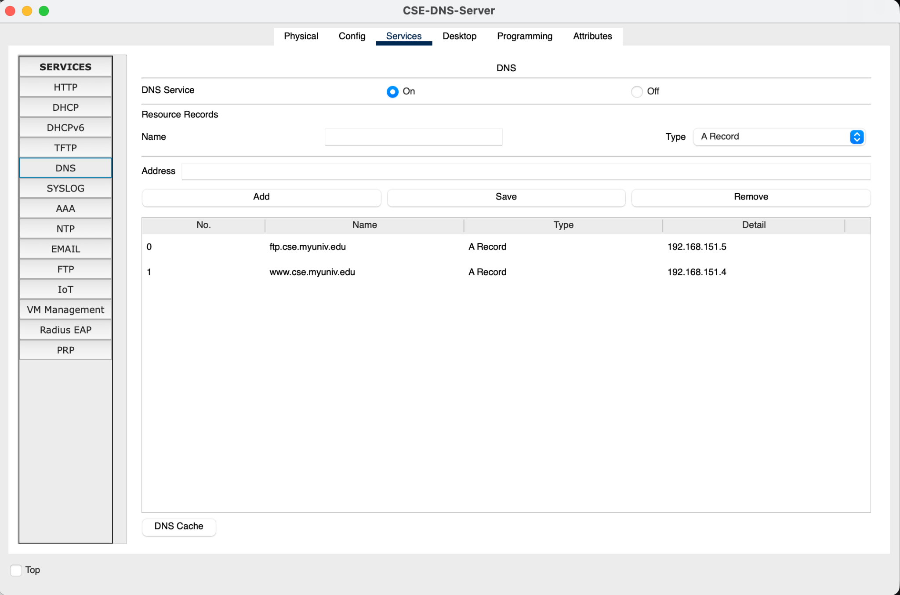 |

| Workstation Dynamic IP & DNS Option | DNS Name Resolution Verification |
| :---: | :---: |
| 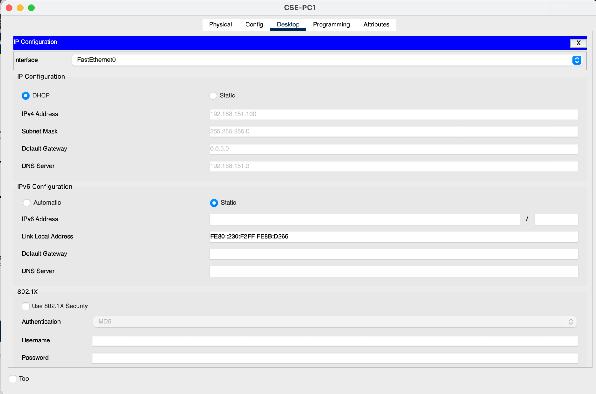 | 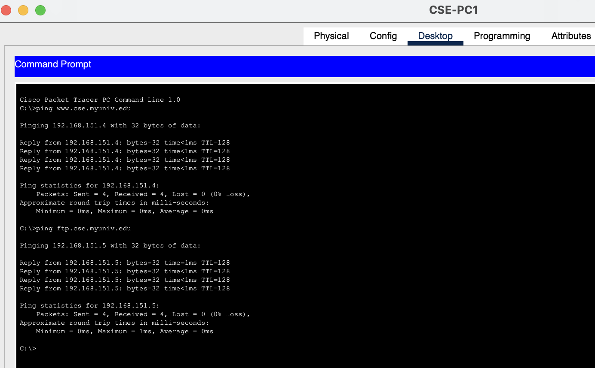 |

| Web Browser Accessing Custom Webpage | Interactive Authenticated FTP Session |
| :---: | :---: |
| 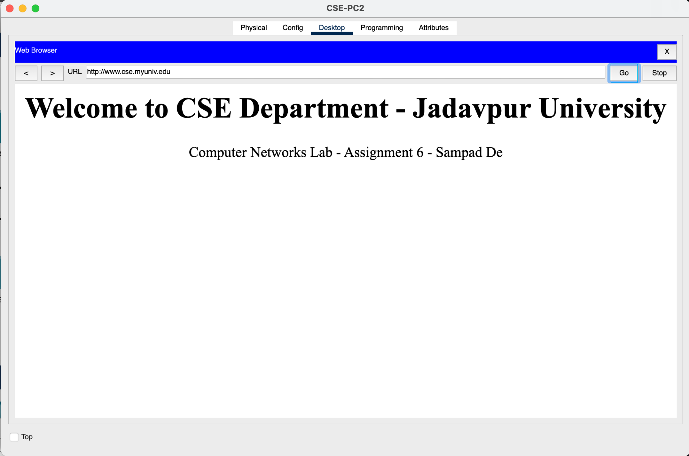 | 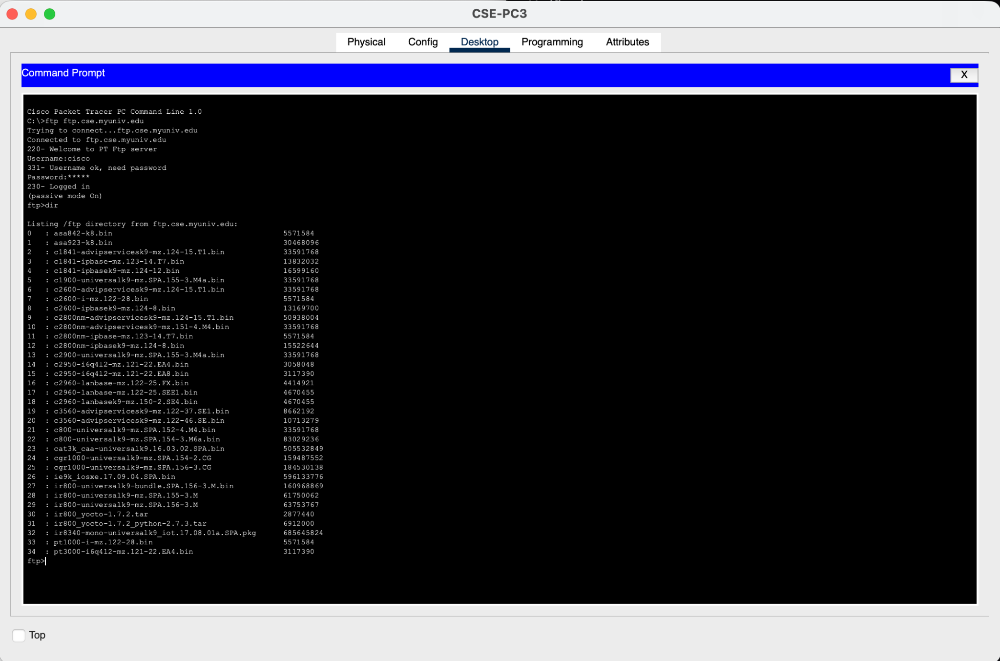 |

**Application Verification:**
1. `ping www.cse.myuniv.edu` and `ping ftp.cse.myuniv.edu` resolved to their respective server IP addresses via UDP port 53.
2. PC2's Web Browser rendered the customized web page: *"Welcome to CSE Department - Jadavpur University / Computer Networks Lab - Assignment 6 - Sampad De"*.
3. PC3 established an authenticated FTP connection (`cisco` / `cisco`), navigated directories, and executed `dir` file listings over TCP port 21.

---

## 10. Conclusion & Key Takeaways

1. **Crossover vs Straight-Through Media:** Directly connected terminal devices (MDI-to-MDI) require a crossover cable to connect transmit pins ($TX$) to receive pins ($RX$).
2. **Micro-segmentation:** Switches eliminate collision domains per port and dynamically learn source MAC addresses into CAM tables, preventing unnecessary frame flooding.
3. **Subnetting vs Switching:** Flat Layer-2 bridging across disparate IP subnets drops packets unless an active Layer-3 default gateway forwards across network boundaries.
4. **Static Routing & Gateway Forwarding:** Routers interconnect disparate subnets across synchronous serial WAN links using routing tables (`ip route`) and gateway decrementation of IPv4 TTL.
5. **DORA & Name Resolution:** Enterprise networks rely on DHCP for scalable automatic parameter configuration and DNS for decoupling numerical IP addresses from application service delivery.

---

## 11. References

1. **Project Source Code Repository:** [https://github.com/Sampad2006/CN-Lab-Assignments](https://github.com/Sampad2006/CN-Lab-Assignments)
2. **AI Assistance:** AI (Gemini 3.8 Flash) was utilized to generate latex chart configurations and also to use Cisco Packet Tracer. All specific setups, screenshots, and answers I have done myself.
